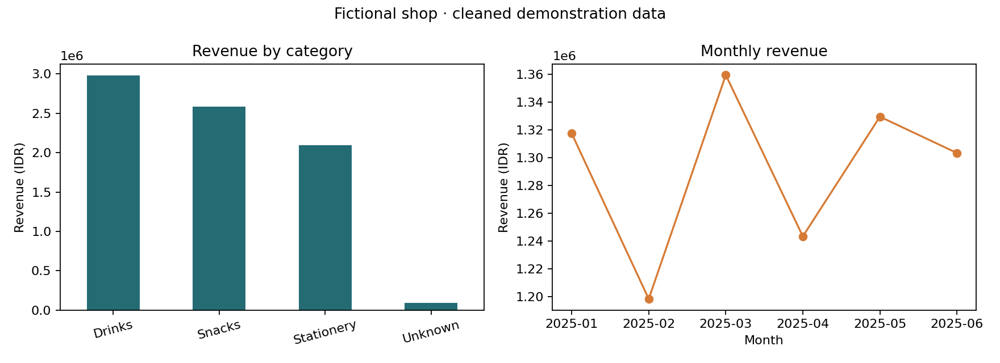

# Retail Sales Analysis with CRISP-DM

A reproducible sales reporting pipeline that cleans transaction data, calculates revenue, and summarizes performance by product category and month. The analysis follows CRISP-DM and records data-quality decisions in an audit.

## Results

| Measure | Result |
|---|---:|
| Valid transactions | 176 |
| Revenue after discounts | IDR 7,750,500.00 |
| Average transaction value | IDR 44,036.93 |
| Largest category by revenue | Drinks |

Results are calculated from the included **synthetic dataset**. [View the example report](docs/example-report.md).

## Methodology

| CRISP-DM phase | Implementation |
|---|---|
| Business understanding | Define category contribution and monthly revenue as the reporting questions. |
| Data understanding | Inspect data types, missing values, duplicates, and invalid records. |
| Data preparation | Remove exact duplicates and invalid transactions; normalize labels; retain missing categories as Unknown. |
| Modeling | Aggregate revenue by category and month using descriptive analysis. |
| Evaluation | Reconcile grouped totals with overall revenue and review the cleaning audit. |
| Deployment | Export cleaned data, summary tables, a report, and charts through a reusable script. |

Revenue is calculated as quantity × unit price × (1 − discount). Average transaction value is total revenue divided by the number of valid transactions.

Cleaning removes one exact duplicate and four invalid rows from 181 input rows. A missing category is retained as Unknown. Conflicting transaction IDs stop the analysis rather than being silently combined.

## Dataset

[sales.csv](data/sales.csv) contains 180 fictional transactions from January to June 2025 and one repeated row. [make_demo_data.py](make_demo_data.py) reproduces the data and its documented quality issues.

| Field | Description |
|---|---|
| transaction_id | Unique transaction identifier; one row per complete transaction |
| date | Transaction date in YYYY-MM-DD format |
| category | Product category |
| branch | Campus or City |
| quantity | Positive whole number of items |
| unit_price | Price per item in IDR |
| discount | Fraction from 0 to 1; 0.10 represents 10% |

## Installation and usage

Requires **Python 3.11–3.13**.

~~~bash
git clone https://github.com/Farscent/retail-sales-crisp-dm.git
cd retail-sales-crisp-dm
python -m venv .venv
~~~

Activate the environment with <code>.\.venv\Scripts\Activate.ps1</code> on Windows PowerShell or <code>source .venv/bin/activate</code> on macOS/Linux.

~~~bash
python -m pip install -r requirements.txt
python analysis.py
~~~

The included data runs offline after dependency installation.

A CSV with the same schema can be supplied with <code>--input</code>; <code>--output</code> selects the destination directory.

~~~bash
python analysis.py --input data/sales.csv --output outputs
~~~

## Outputs

| File | Contents |
|---|---|
| outputs/report.md | Written findings |
| outputs/summary.json | Cleaning audit and headline measures |
| outputs/clean_sales.csv | Valid transactions with calculated revenue |
| outputs/revenue_by_category.csv | Category totals |
| outputs/monthly_revenue.csv | Monthly totals |
| outputs/sales_overview.png | Category and monthly revenue charts |

Generated outputs are excluded from version control; representative results are included under docs.

## Interpretation and limitations

Drinks contributes the most revenue in the sample. Profitability cannot be assessed because product costs are unavailable.

The dataset is fictional, and the final month is incomplete. Monthly totals therefore require caution when comparing periods. Excluding invalid records reduces reported revenue; real reporting would require checking those records against the source. The transaction-level denominator would also need adjustment for item-level order data.

## Notebook

[View the analysis notebook](walkthrough.ipynb) for intermediate tables, visualizations, and saved outputs. To run it locally:

~~~bash
python -m pip install -r requirements-notebook.txt
python -m notebook walkthrough.ipynb
~~~

## Validation

Tests cover cleaning counts, revenue calculations, total reconciliation, invalid inputs, conflicting IDs, and report generation. CI also verifies dataset reproducibility and executes the notebook.

~~~bash
python -m unittest discover -s tests -v
~~~

GitHub Actions runs the checks on Python 3.11 and 3.12. The project has also been verified on Windows with Python 3.13.

## References

- [IBM: CRISP-DM overview](https://www.ibm.com/docs/en/spss-modeler/saas?topic=dm-crisp-help-overview)
- [pandas documentation](https://pandas.pydata.org/docs/)

## License

Code and synthetic demonstration data are available under the [MIT License](LICENSE).
